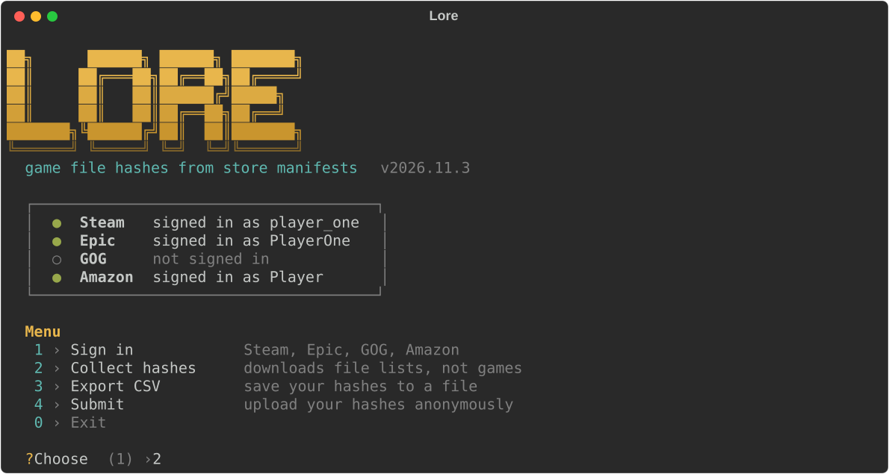
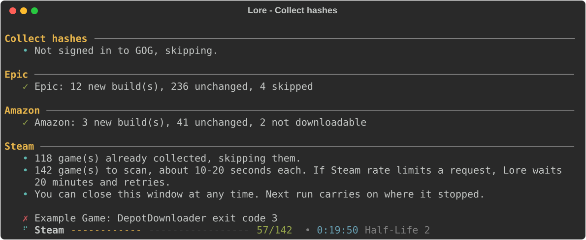
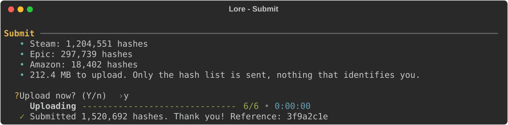

# Lore

Builds known-file hash sets from your Steam, Epic Games Store, GOG and Amazon Games libraries. No
game files are downloaded.

Each store publishes a manifest for every build, listing every file with its hash. Lore downloads
those manifests for the games you own and saves the hashes.

| Store | Hashes | Builds |
|---|---|---|
| Steam | SHA1 | Latest build of each Windows depot |
| Epic | SHA1, plus MD5 and SHA256 on newer manifests | Latest build. Each run adds any new builds. |
| GOG | MD5, plus SHA256 on some newer builds | Latest build. Each run adds any new builds. |
| Amazon Games | SHA256 | Latest build. Each run adds any new builds. |

## Running it

Download `lore.exe` from the [latest release](../../releases/latest) and double-click it. There's
nothing to install. If Windows shows "Windows protected your PC", click **More info**, then
**Run anyway**.

### 1. Sign in

Sign in to each store you use. You only need to do this once.

- **Steam:** scan the QR code with the Steam mobile app. You don't enter a password. Then enter a
  Steam Web API key and your profile URL (see [Steam API key](#steam-api-key) below).
- **Epic, GOG and Amazon:** your browser opens. Sign in, then paste back the code (Epic) or the
  final page URL (GOG and Amazon).

### 2. Collect hashes

Pick one store or All. All does Epic, GOG and Amazon, then Steam, as Steam is the slowest (about
10-20 seconds per game). If Steam rate limits a request, Lore waits 20 minutes and retries.

You can close it at any time. The next run skips anything already collected.

### 3. Export CSV

Saves one CSV with everything collected, from all stores or just one, in `lore_files`.

### 4. Submit

Uploads your hashes anonymously. Only the hash list is sent: no account names, IDs or anything
else that identifies you. It shows what will be sent and asks before uploading.

## Steam API key

Lore uses a Steam Web API key to get the list of games you own. It's free and takes a minute.

1. Go to https://steamcommunity.com/dev/apikey and sign in with your Steam account.
2. For **Domain Name**, enter `localhost`. It isn't used, but Steam needs something.
3. Tick the terms box and click **Register**. Steam may ask you to confirm in the Steam mobile app.
4. Copy the key (32 letters and numbers) and paste it into Lore when it asks.

Lore also asks for your **profile URL**. In Steam, click your name at the top, then **Profile**,
and copy the address, e.g. `https://steamcommunity.com/id/yourname/`. Your SteamID64 (17 digits)
works too.

Things to know:

- **Limited accounts can't get a key.** Steam only gives keys to accounts that have spent at least
  $5 in the Steam store.
- **Keep the key to yourself.** Lore only uses it to read your game list, but anyone with it can
  read your public Steam data. If it gets out, revoke it on the same page and make a new one.
- **"Steam returned no games"** usually means your game details are private. In Steam, go to your
  profile, **Edit Profile** > **Privacy Settings**, and set **Game details** to **Public**.

## Files

Lore keeps its files in a `lore_files` folder next to the exe. Logins are kept separately.

| What | Where |
|---|---|
| Steam | `lore_files\steam.sqlite` and `lore_files\steam_config.json` |
| Epic, GOG, Amazon | `lore_files\lore.sqlite` and `lore_files\manifests\` |
| Exports | `lore_files\lore_<store>_<date>_<time>.csv` |
| Log, all stores | `lore_files\logs\lore_<date>_<time>.log`, one per run |
| Epic, GOG, Amazon logins | `%USERPROFILE%\.lore\`. Keep these private, like passwords. |
| Steam login | Saved by DepotDownloader in your Windows user profile |

## Problems

- **Steam asks you to sign in again.** The Steam login is tied to where Lore's folder is. If you
  move the folder, sign in to Steam once more.
- **Steam sign in has expired.** Choose **Sign in** > **Steam** again. Collecting carries on where
  it stopped.
- **Something else went wrong.** Each run writes a log in `lore_files\logs` with the full details,
  for every store.

## Notes

- The hashes come straight from the stores' manifests. Lore doesn't hash any files itself.
- Epic, GOG and Amazon support is based on [Legendary](https://github.com/derrod/legendary),
  [heroic-gogdl](https://github.com/Heroic-Games-Launcher/heroic-gogdl) and
  [nile](https://github.com/imLinguin/nile).
- DepotDownloader is GPL-2.0. Lore runs it as a separate program and copies its licence into
  `lore_files`.
